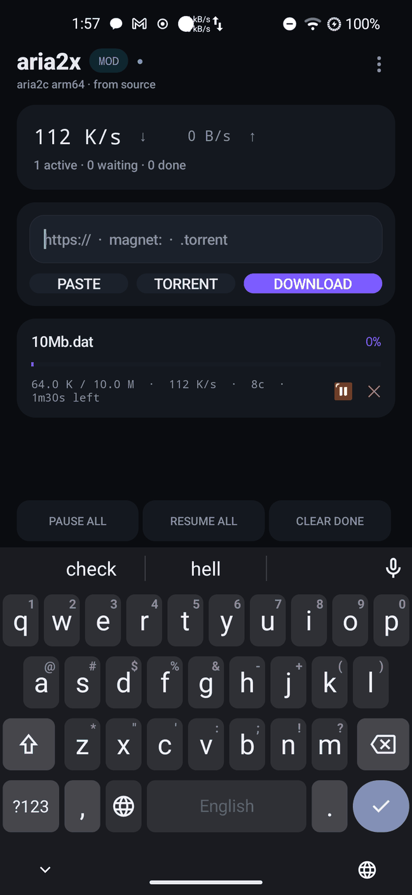
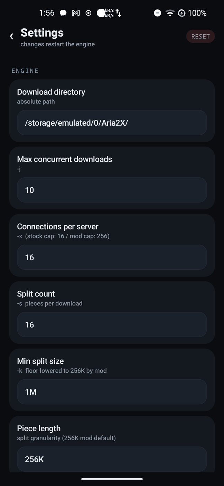
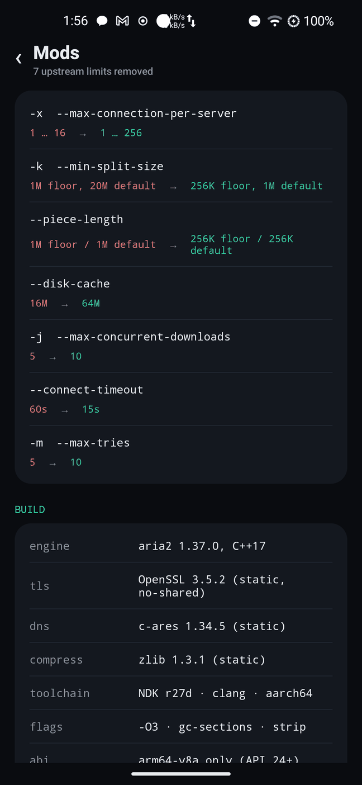
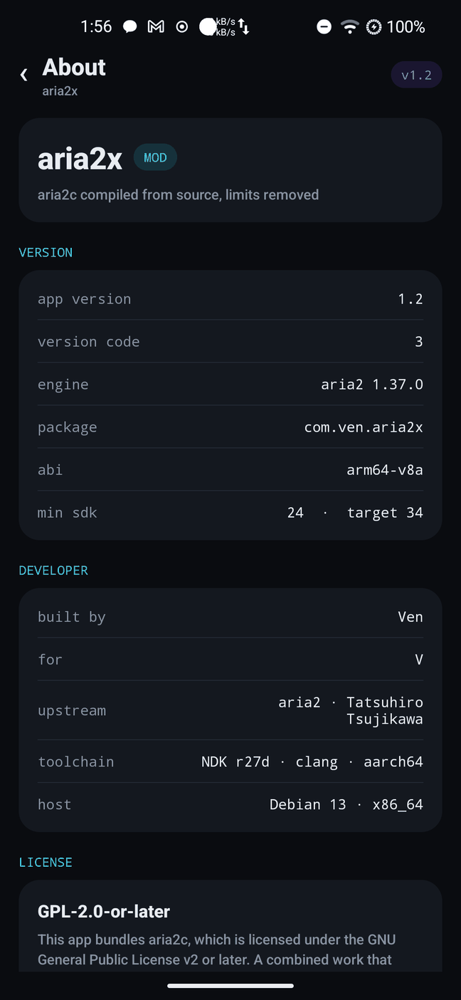

# aria2x

An Android download manager built on **aria2c compiled from source**, with the
upstream limits that throttle modern connections removed — plus a small native
front-end that speaks to it over JSON-RPC.

No Termux. No Gradle. No AndroidX. One 3.7 MB APK containing an 8 MB `arm64`
aria2c, statically linked against its own OpenSSL, c-ares and zlib.

```
aria2c 1.37.0  ·  OpenSSL 3.5.2  ·  c-ares 1.34.5  ·  zlib 1.3.1
NDK r27d clang  ·  -O3  ·  arm64-v8a  ·  API 24+
```

<p align="center">
  
  
  
  
</p>

---

## Why

aria2's defaults were tuned for a 2009 internet. Some of them are hard caps in
the source, not tuning knobs — `--max-connection-per-server` physically refuses
anything above 16, and the split engine won't divide a file into segments
smaller than 1 MiB. On a modern connection those limits, not the network, are
what you hit.

aria2x rebuilds aria2c from the original 1.37.0 release tarball with seven of
those limits relaxed, then ships it inside an Android app.

## The modifications

| Option | Stock | aria2x |
| --- | --- | --- |
| `-x, --max-connection-per-server` | 1 … 16 | **1 … 256** |
| `-k, --min-split-size` | 1M floor, 20M default | **256K floor, 1M default** |
| `--piece-length` | 1M floor, 1M default | **256K floor, 256K default** |
| `--disk-cache` | 16M | **64M** |
| `-j, --max-concurrent-downloads` | 5 | **10** |
| `--connect-timeout` | 60 s | **15 s** |
| `-m, --max-tries` | 5 | **10** |

The `-k` and `--piece-length` changes matter more than `-x`. Stock aria2 refuses
to split anything under 1 MiB, so small files get a single connection no matter
what you set `-x` to. At 256K granularity the split engine actually engages.

One behavioural fix is included as well: aria2 1.37 aborts at startup if it
cannot load OpenSSL's *legacy* provider. Statically linked OpenSSL builds that
provider as a separate DSO, so on Android it always fails. `Platform.cc` now
warns instead of throwing (the only casualty is RC4, used by BitTorrent MSE).

Patch: [`patches/0001-aria2x-limits.patch`](patches/0001-aria2x-limits.patch)

## Features

- **HTTP / HTTPS / FTP**, segmented multi-connection downloads
- **BitTorrent and magnet links**, DHT, session persistence across restarts
- **Persistent queue** — unfinished downloads resume on next launch
- **Foreground service** with partial wake lock, so downloads survive screen-off
- **Live progress** — speed, ETA, connection count per download, polled over
  loopback JSON-RPC once a second
- **Per-download control** — pause, resume, remove
- **Full option surface** in a generated Settings screen: connections, splits,
  rate limits, proxy, headers, user agent, retries, disk cache, seeding, and a
  raw `key=value` escape hatch for anything not exposed
- **Torrent file picker** and URL/magnet/multi-URL input
- No accounts, no telemetry, no ads

## Install

Download `aria2x.apk` from [Releases](../../releases) and install it.

```
adb install -r aria2x.apk
```

`minSdk 24` (Android 7.0), `targetSdk 34`, **arm64-v8a only**.

On first launch the app asks where downloads should go. Granting *all-files
access* lets it write to `/sdcard/Aria2X`, where any file manager can see it.
Declining is fine — files are then kept in app-private storage.

## Build from source

Requires Linux/macOS, JDK 17+, Python 3, `curl`, and the Android SDK
(`build-tools;34.0.0`, `platforms;android-34`) plus NDK r27d.

```sh
export NDK=$HOME/android-ndk-r27d
export ANDROID_HOME=$HOME/Android/Sdk

./build-deps.sh        # zlib + OpenSSL + c-ares, static, for arm64
./build-aria2.sh       # applies patches, configures, builds, strips -> dist/aria2c
./build-apk.sh         # aapt2 + javac + d8 + zipalign + apksigner -> dist/aria2x.apk
```

`build-apk.sh` generates the launcher icons and a signing key on first run. The
key is written to `keystore.jks` and is **git-ignored** — use your own for a
public release.

Reproducing only the engine is enough to verify the patches:

```sh
curl -LO https://github.com/aria2/aria2/releases/download/release-1.37.0/aria2-1.37.0.tar.gz
tar xf aria2-1.37.0.tar.gz && cd aria2-1.37.0
patch -p1 < ../patches/0001-aria2x-limits.patch
```

## Repository layout

```
app/                 Android app — manifest, Java sources, assets, icons
  java/com/ven/aria2x/
    MainActivity.java      download list, add bar, polling
    SettingsActivity.java  generated from Prefs.FIELDS
    AboutActivity.java     version, licenses, attribution
    ModsActivity.java      what the patches change
    Engine.java            foreground service, process lifecycle
    Rpc.java               loopback JSON-RPC client
    Prefs.java             option store + aria2.conf generator
    Ui.java                small design system
patches/             aria2 patches, apply with `patch -p1`
env.sh               cross-compilation environment
build-deps.sh        static zlib, OpenSSL, c-ares
apply-mods.py        applies patches (idempotent, asserted)
build-aria2.sh       engine build
build-apk.sh         APK assembly and signing
make-icon.py         launcher icon generation
```

## How the engine runs

Android blocks `execve` on files in an app's writable data directory for any app
targeting API 29 or later — the restriction Termux sidesteps by pinning its
`targetSdk` to 28. aria2x takes the supported route instead: the binary ships as
`lib/arm64-v8a/libaria2c.so` with `android:extractNativeLibs="true"`, so the
package manager extracts it into `nativeLibraryDir`, which is executable.

On start the foreground service writes `files/aria2.conf` from the current
settings, spawns the binary with `--conf-path`, and talks to it over
`127.0.0.1` JSON-RPC with a per-install random secret. Settings changes restart
the engine; the queue is restored from `files/aria2.session`.

The binary is linked against Android's `libc`/`libm`/`libdl` but keeps OpenSSL,
c-ares and zlib inside itself, so nothing has to be installed alongside it.

## Verified

On an ARM64 device (Android 13):

- engine starts, RPC answers, 10 MB file downloads to completion
- `-x 256` accepted, `-x 257` rejected with *"must be between 1 and 256"*
- `-k 256K` accepted, `-k 200K` rejected
- `aria2.getGlobalOption` reports every modified default
- `changeGlobalOption {max-connection-per-server: 200}` succeeds at runtime
  (stock aria2 rejects it)

## Limitations

- **arm64-v8a only.** No 32-bit build.
- **No RC4.** Static OpenSSL builds the legacy provider as a separate DSO, so
  BitTorrent MSE connections requiring `arc4` will not negotiate. Modern TLS,
  plaintext peers, and everything HTTP are unaffected.
- `-x 256` exists because the ceiling should be yours to choose; most CDNs will
  rate-limit or `503` well before that. 16–32 is the sane range in practice.
- BitTorrent piece length is unaffected by `--piece-length` (that option is
  HTTP/FTP only).
- No proxy auto-configuration, no Metalink.

## License

**GPL-2.0-or-later.** aria2 is GPL-2.0-or-later, and distributing its binary
inside this app makes the combined work GPL-2.0-or-later too. Full text in
[LICENSE](LICENSE); third-party terms and the OpenSSL exception in
[NOTICE.md](NOTICE.md).

Corresponding source for the modified engine is this repository: the exact
upstream tarball, the patch, and the build scripts that produce the shipped
binary.

## Credits

- **aria2** — Tatsuhiro Tsujikawa and contributors
- **OpenSSL**, **c-ares**, **zlib**
- Build tooling: Android NDK r27d, `aapt2`, `d8`, `apksigner`

Built by [@cantwin-ctrl](https://github.com/cantwin-ctrl).
